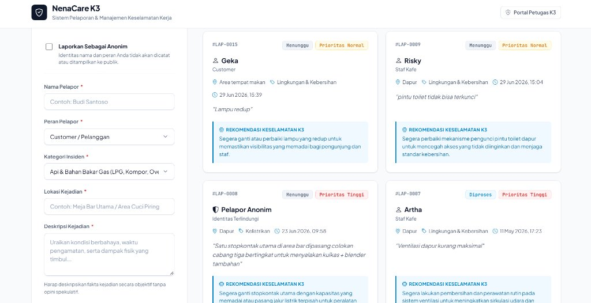
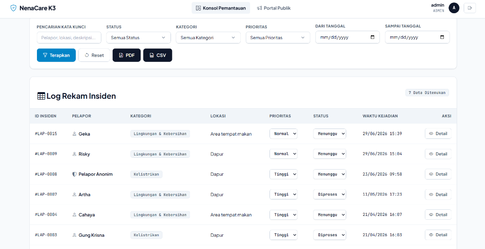
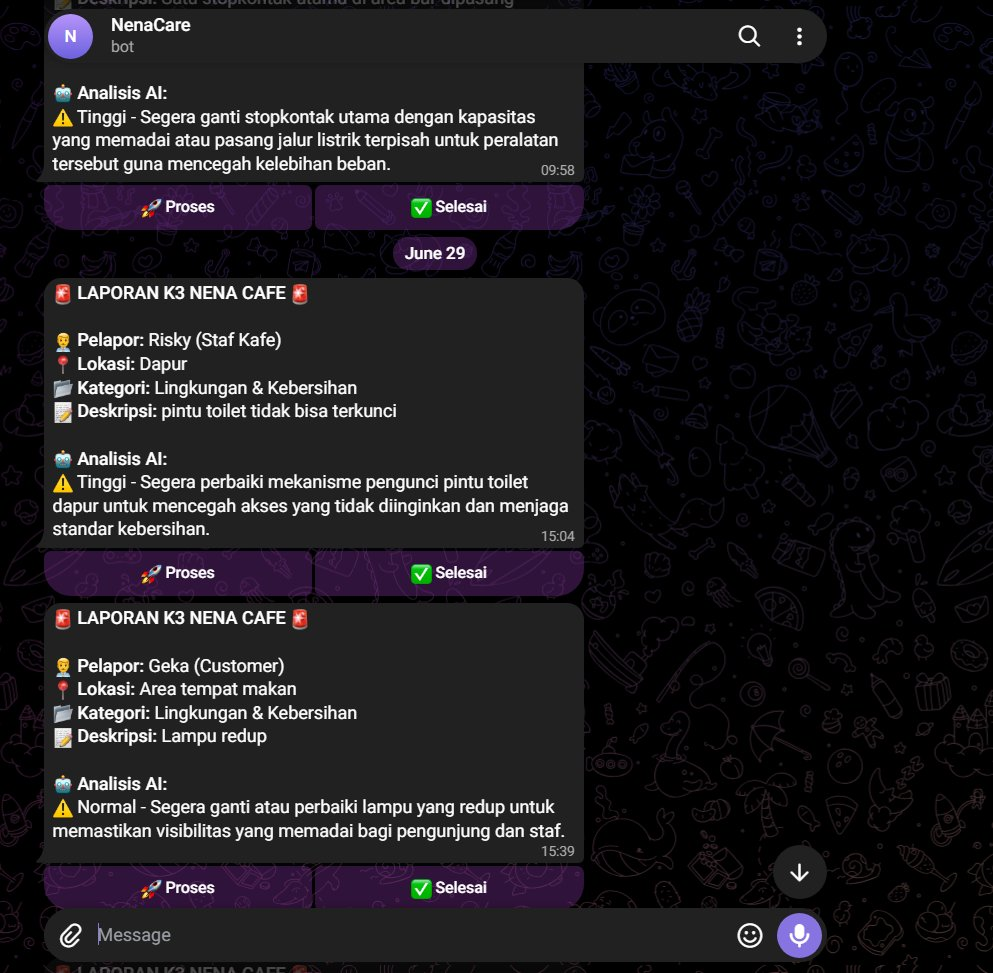

# NenaCare - Enterprise OHS Incident Management & Monitoring System

A robust, full-stack incident reporting and Occupational Health and Safety (OHS / K3) management platform designed for the commercial Food and Beverage (F&B) industry.

The platform combines real-time incident intake, automated severity evaluation powered by Google Gemini AI, dual-channel mobile dispatch via Telegram Bot with remote callbacks, an analytical operations console with Chart.js visualizations, live multi-column filtering, raw CSV dataset extraction, and regulatory PDF compliance audit compilation.

---

## Visual Previews

### 1. Public Incident Intake & Live Incident Feed
A clean, airy interface featuring single-layer elevated incident cards, category filtering tabs, live client-side search, and whistleblower anonymity options.



### 2. Safety Inspector & Operations Console
A comprehensive administrative dashboard delivering high-density tabular incident logs, multi-parameter search, inline status dispatching, and dynamic chart distributions.



### 3. Telegram Bot Two-Way Incident Dispatch
Automated instant dispatch to safety supervisors with interactive inline keyboards for remote incident progression.



---

## Design System & Interface Architecture

NenaCare is built on a clean, light-mode design architecture engineered for operational speed, readability, and visual comfort:

- **Clean Light Palette**: Built on a soft slate canvas (`#f8fafc`) paired with crisp white cards (`#ffffff`), subtle borders (`#e2e8f0`), and deep sapphire accents (`#0284c7`), avoiding excessive dark-mode fatigue.
- **Single-Layer Card Structure**: Eliminates nested container clutter ("cards within cards"). Reports, form toggles, and metadata flow naturally with intentional whitespace and subtle elevation (`0 1px 3px rgba(0, 0, 0, 0.07)`).
- **Strict Typographic Hierarchy**: Employs *Plus Jakarta Sans* for headings and body content, paired with *JetBrains Mono* for tracking codes (`#LAP-0015`), timestamps, and tabular data.
- **Zero Emojis**: Every interface element, select option, timeline milestone, and alert banner utilizes crisp vector icons (Bootstrap Icons) and formal technical terminology.

---

## System Architecture

```
[ Field Incident Occurrence ]
              |
              v
  [ Public Intake Portal ] ----> (Optional Anonymous Mode)
              |
              v
[ Backend Dispatcher & Gemini LLM ]
   |-- Automated Severity Scoring (High / Normal / Low)
   `-- Actionable Mitigation Advisory Generation
              |
              +---> [ Relational Database (MySQL / MariaDB) ]
              |
              +---> [ Telegram Bot Alerts & Interactive Callbacks ]
              |
              `---> [ Operations Console & Chart.js Analytics ]
                          |
                          +---> [ Standardized PDF Compliance Audit ]
                          |
                          `---> [ Raw CSV Dataset Export ]
```

---

## Core Capabilities

### 1. Hazard Intake & Whistleblower Privacy
- **Public & Anonymous Submissions**: Reporters can submit incidents identified by name and operational role or enable anonymous mode to sanitize reporter identity in database records.
- **Role Categorization**: Captures role context across Customers, Operational Staff, Baristas, Kitchen Staff, and Facility Technicians.
- **Standardized Hazard Domains**: Intake forms standardize incidents across critical domains:
  - Fire & Combustible Gases (LPG, Stoves, Ovens)
  - Electrical Systems (Short Circuits, Exposed Wiring, Switchboards)
  - Environmental Sanitation (Slippery Floors, Spills, Smoke Dispersion)
  - Ergonomics & Personal Protective Equipment (Sharp Objects, Burns, PPE Compliance)

### 2. Automated AI Severity Scoring & Action Protocols
- **Triaged Severity Evaluation**: Powered by Google Gemini 2.5 Flash-Lite API, evaluating incident risk into three standardized tiers: High, Normal, and Low.
- **Immediate Mitigation Advisories**: Generates clear, non-speculative corrective instructions for on-site supervisors before field technicians arrive.

### 3. Telegram Two-Way Integration
- **Immediate Push Alerts**: Automatically notifies safety managers via Telegram upon incident creation.
- **Remote Lifecycle Dispatch**: Inline callback queries allow supervisors to advance incident lifecycle status (Pending, In Progress, Resolved) directly from mobile devices.

### 4. Interactive Monitoring & Real-Time Filtering
- **Live Search**: Instant client-side search filtering by keywords, location names, and description terms.
- **Pill Category Filters**: Instant switching between incident domains without page reloading.
- **Single-Layer Cards**: Structured cards presenting incident tracking numbers, timestamps, status indicators, and AI advisories.

### 5. Administrative Operations Console
- **KPI Metrics**: Real-time summary counters for Total Incidents, Pending Review, In Progress, Resolved, High-Priority Hazards, and Overall Resolution Rate percentage.
- **Visual Analytics**: Interactive Doughnut chart for status breakdown and Bar chart for category frequency via Chart.js.
- **Multi-Parameter Search**: Server-side query filtering across keywords, status, domain category, priority tier, and date intervals.
- **Inline Dispatching**: Live dropdown selectors to update status and priority directly from table rows.

### 6. Investigation Dossiers & Audit Trails
- **Three-Stage Lifecycle Progression**: Tracks milestones across Intake Logged, Field Action, and Final Verification.
- **One-Click Quick Actions**: Single-click supervisor triggers to initiate progress or mark incidents resolved.
- **Internal Investigation Notes**: Audit trail for recording field findings, technician assignments, and compliance remarks.
- **Print Stylesheet Ready**: Built-in `@media print` layout for compiling physical paper dossiers without navigation headers.

### 7. Dual Regulatory Export Engines
- **Standardized A4 Landscape PDF**: Formal audit document compiled via Dompdf, including official header, summary tables, active filter metadata, and supervisor sign-off signature blocks.
- **Raw CSV Dataset Export**: Structured CSV export formatted with UTF-8 BOM encoding for direct, artifact-free analysis in Microsoft Excel or business intelligence platforms.

---

## Technology Stack

| Layer | Technologies |
| :--- | :--- |
| **Backend Framework** | PHP 8.1+ (Object-Oriented Architecture, Prepared Statements, MySQLi) |
| **Database** | MySQL 5.7+ / MariaDB 10.4+ (Relational schema with foreign keys and cascade safety) |
| **Artificial Intelligence** | Google Gemini 2.5 Flash-Lite API (REST endpoints) |
| **Messaging & Bot API** | Telegram Bot API (Long polling / Webhooks & Inline Keyboards) |
| **Document Compiler** | Dompdf 3.1 |
| **Frontend UI** | HTML5, CSS3 Custom System (Modern Light Architecture), ES6+ JavaScript |
| **Iconography** | Bootstrap Icons |
| **Data Visualization** | Chart.js 4.4 |

---

## Directory Structure

```
NenaCare/
|-- assets/
|   |-- css/
|   |   `-- style.css          # Modern Light Theme Design System
|   |-- preview-admin.png      # Operations console screenshot
|   |-- preview-public.jpg     # Public intake portal screenshot
|   `-- preview-telegram.jpg   # Telegram dispatch screenshot
|-- classes/
|   |-- AuthManager.php        # Session governance, role enforcement, and authentication
|   |-- Facility.php           # Facility base abstraction
|   |-- ElectronicFacility.php # Electronic asset model
|   |-- FurnitureFacility.php  # Furniture asset model
|   `-- ReportManager.php      # Incident lifecycle engine, analytics, and external APIs
|-- admin.php                  # Supervisor command console and analytics dashboard
|-- bot_listener.php           # Telegram polling daemon for remote callbacks
|-- config.php                 # Environment loader and database connection pool
|-- database.sql               # Relational database schema definitions
|-- debug_ai.php               # Diagnostic utility for Gemini API endpoints
|-- detail.php                 # Investigation dossier, timeline, and audit notes
|-- export_csv.php             # Raw CSV dataset exporter with UTF-8 BOM
|-- export_pdf.php             # Standardized PDF compliance audit compiler
|-- index.php                  # Public hazard reporting portal and live feed
|-- login.php                  # Administrative authentication portal
|-- logout.php                 # Session invalidation handler
|-- composer.json              # Dependency package specifications
`-- README.md                  # Comprehensive system documentation
```

---

## Database Schema

```sql
CREATE DATABASE IF NOT EXISTS db_nena_k3;
USE db_nena_k3;

CREATE TABLE IF NOT EXISTS users (
  id_user INT AUTO_INCREMENT PRIMARY KEY,
  username VARCHAR(50) NOT NULL,
  password VARCHAR(255) NOT NULL,
  role ENUM('Admin', 'Manajer') NOT NULL
);

CREATE TABLE IF NOT EXISTS laporan_k3 (
  id_laporan INT AUTO_INCREMENT PRIMARY KEY,
  nama_pelapor VARCHAR(100) NULL,
  tipe_pelapor VARCHAR(20) NULL,
  kategori_masalah VARCHAR(50) NOT NULL,
  lokasi_kejadian VARCHAR(100) NOT NULL,
  deskripsi_kejadian TEXT NOT NULL,
  is_anonim TINYINT(1) DEFAULT 0,
  prioritas ENUM('Rendah', 'Normal', 'Tinggi') DEFAULT 'Normal',
  saran_ai TEXT,
  status ENUM('Menunggu', 'Diproses', 'Selesai') DEFAULT 'Menunggu',
  telegram_message_id BIGINT,
  waktu_lapor TIMESTAMP DEFAULT CURRENT_TIMESTAMP
);

CREATE TABLE IF NOT EXISTS catatan_admin (
  id_catatan INT AUTO_INCREMENT PRIMARY KEY,
  id_laporan INT NOT NULL,
  id_user INT NOT NULL,
  catatan TEXT NOT NULL,
  waktu_catatan TIMESTAMP DEFAULT CURRENT_TIMESTAMP,
  FOREIGN KEY (id_laporan) REFERENCES laporan_k3(id_laporan) ON DELETE CASCADE,
  FOREIGN KEY (id_user) REFERENCES users(id_user) ON DELETE CASCADE
);
```

---

## Installation & Configuration

### Prerequisites
- PHP 8.1 or higher with `mysqli`, `curl`, `mbstring`, and `openssl` extensions enabled
- MySQL 5.7+ or MariaDB 10.4+
- Composer (PHP Dependency Manager)
- Google Gemini API Key
- Telegram Bot Token and Supervisor Chat ID

### Step-by-Step Setup

1. **Clone the Repository**:
   ```bash
   git clone https://github.com/ANTARTICA1/NenaCare.git
   cd NenaCare
   ```

2. **Install PHP Dependencies**:
   ```bash
   composer install
   ```

3. **Configure Environment Variables**:
   Copy `.env.example` to `.env` and populate your credentials:
   ```ini
   DB_HOST=localhost
   DB_USER=root
   DB_PASS=
   DB_NAME=db_nena_k3

   # Google Gemini API
   GEMINI_API_KEY=your_gemini_api_key_here

   # Telegram Bot Configuration
   BOT_TOKEN=your_telegram_bot_token_here
   ADMIN_ID=your_telegram_chat_id_here
   ```

4. **Initialize Database Tables**:
   Import `database.sql` into your database server, or allow `config.php` to construct tables automatically upon the first HTTP request:
   ```bash
   mysql -u root -p db_nena_k3 < database.sql
   ```

5. **Start Telegram Listener Daemon (Optional for Local Polling)**:
   ```bash
   php bot_listener.php
   ```

6. **Access the Endpoints**:
   - Public Intake Portal: `http://localhost/NenaCare/index.php`
   - Operations Console: `http://localhost/NenaCare/login.php`

---

## Default Access Credentials

The initial database bootstrap provisions the following default supervisor account:

- **Portal URL**: `http://localhost/NenaCare/login.php`
- **Username**: `admin`
- **Password**: `admin123`
- **Role**: `Admin`

---

## Author

Anak Agung Ngurah Krisna Artha Wibawa ([ANTARTICA1](https://github.com/ANTARTICA1))

---

## License

This project is licensed under the MIT License.
